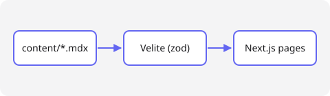

Welcome to the new blog. This post doubles as a **template**: copy this folder,
rename it, and start writing.

## Frontmatter

Every post starts with frontmatter that is validated at build time:

```yaml
title: Hello, world # required
description: One sentence. # required, used for cards, SEO and RSS
date: 2026-11-12 # required
updated: 2026-11-20 # optional
tags: [Meta, Next.js] # optional
draft: true # optional — visible in dev, hidden in production
cover: ./cover.png # optional image next to this file
```

## Code

Syntax highlighting works in both themes:

```ts title="src/features/posts/core.ts"
export function sortByDateDesc<T extends PostLike>(posts: readonly T[]): T[] {
  return [...posts].sort((a, b) => b.date.localeCompare(a.date));
}
```

Inline code like `pnpm dev` works too.

## Math

Inline math: $2^{16} = 65536$ addressable locations. Display math:

$$
\text{CPU time} = \text{instructions} \times \text{CPI} \times \text{clock period}
$$

## Images

Put images next to the post and link them relatively — they are copied and
fingerprinted at build time.



## Callouts

<Callout type="tip">Run `pnpm dev` and edit this file — the page reloads as you type.</Callout>
